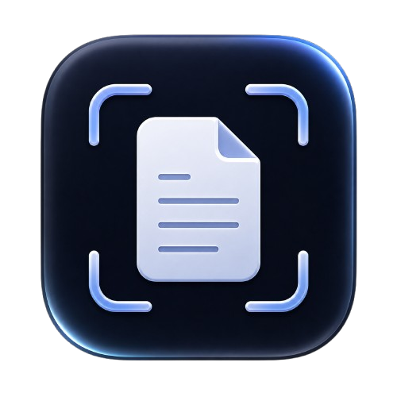

<div align="center">
  
  <h1>QuickOCR</h1>
  <p>Instant, on-device text capture from anywhere on your screen.</p>

  
  
  
  
</div>

---

**v1.1 — made for macOS 27.** Fixes the global shortcut and the endless "Scanning…" hang on macOS 27.

Press **⌘⇧1**, drag a region, and the text is copied to your clipboard instantly. A toast notification slides down from the menu bar to confirm. Everything runs on-device using Apple's Vision framework — nothing is ever sent to a server.

## Features

- **Global shortcut** — customisable (default ⌘⇧1), works in any app
- **On-device OCR** — powered by Apple Vision, no internet required
- **History browser** — searchable log of all captures with timestamps, delete individually or all at once
- **Fully private** — screenshots are deleted immediately after OCR; no analytics, no telemetry
- **Menu bar only** — no Dock icon, stays out of your way
- **Launch at login** — optional, set in Preferences

## What's new in 1.1

- **Works on macOS 27** — Vision's `.accurate` text recognition hangs on macOS 27, so QuickOCR now uses `.fast` recognition (also much quicker; slightly less accurate on very small or stylised text)
- **Shortcut no longer needs Accessibility permission** — uses a system hotkey instead of a global key monitor, so it survives macOS updates
- **Faster crosshair** — capture starts after 150 ms instead of 500 ms
- Packaging supports a stable signing identity (`SIGN_IDENTITY`) so Screen Recording permission survives rebuilds

## Installation

### Option A — Download (recommended)

1. Go to [**Releases**](../../releases/latest) and download `QuickOCR.dmg`
2. Open the DMG and drag **QuickOCR.app** into your Applications folder
3. Launch QuickOCR from Applications
4. On first capture, grant **Screen Recording** access when prompted
   *(System Settings → Privacy & Security → Screen & System Audio Recording)*

> **Gatekeeper note:** Because the app is ad-hoc signed (not notarised), macOS may warn you on first open. Right-click → Open to proceed.

### Option B — Build from source

**Prerequisites:** macOS 13+ (tested on macOS 27), Xcode Command Line Tools

```bash
xcode-select --install   # skip if already installed
```

```bash
git clone https://github.com/VishalT25/QuickOCR.git
cd QuickOCR
bash package.sh
```

This produces `QuickOCR.app` and `QuickOCR.dmg` in the project directory. Drag the app to `/Applications`.

## Usage

| Action | How |
|--------|-----|
| Capture text | Press **⌘⇧1**, drag a region |
| View recent captures | Click the menu bar icon → History |
| Browse all history | Click the menu bar icon → History → Show All History… |
| Change shortcut | Preferences → click the shortcut badge |
| Quit | Menu bar icon → Quit QuickOCR |

## Privacy

All processing happens locally on your Mac:

- Screenshots are written to a temp file, OCR'd, then **immediately deleted**
- History is stored in `UserDefaults` on your device only
- No network requests are made anywhere in the codebase

You can verify this yourself — the entire codebase is in [`Sources/`](Sources/).

## Built with

- **Swift** + **AppKit** / **SwiftUI**
- **Vision framework** — `VNRecognizeTextRequest` for on-device OCR
- **Swift Package Manager** — no Xcode project required

## License

MIT — see [LICENSE](LICENSE).

---

<div align="center">Made by <a href="https://github.com/VishalT25">Vishal</a></div>
